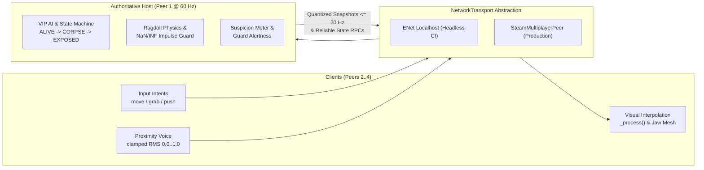

<div align="center">

# BODYGUARD INC.

**2–4 Player Co-op Physics Chaos Game — Built on Godot 4.3+ with Autonomous Gemini Agent Engineering Infrastructure**

[](https://godotengine.org/)
[](#engineering-constitution)
[](#multiplayer-authority-architecture)
[](#anti-leak--security-shield)
[](#quick-commands)
[](LICENSE)

</div>

---

## Concept & Core Loop

You and 1–3 friends are underpaid corporate bodyguards hired to escort a **chronically suicidal, low-IQ AI VIP** through high-profile galas, rooftop parties, and red-carpet events.

1. **Protect the VIP (Alive):** Intercept sniper lasers, tackle the VIP away from balconies and champagne fountains, and herd them toward objectives.
2. **"Weekend at Bernie's" Protocol (Corpse):** If the VIP dies *unnoticed*, **the mission is not over**. Grab the limp ragdoll corpse together, prop them upright, and drag them through checkpoints so guards and paparazzi never find out.
3. **Proximity Voice Lip-Sync:** When suspicious guards walk up and question the VIP, **talk into your microphone** — your proximity voice RMS animates the corpse's jaw in real time to bluff past inspection. Stay silent and suspicion spikes; scream too loud and you blow your cover.

---

## Multiplayer Authority Architecture

All authoritative simulation runs on the **Host (`peer_id == 1`)** at a deterministic fixed `60 Hz` tick rate (`_physics_process`). Clients send only clamped input intents and normalized voice RMS floats (`[0.0, 1.0]`).



---

## Quickstart & How to Play

### 1. Launch the Game (`The Penthouse Gala`)
```bash
make play
```
*(If Godot 4.3+ is not yet installed, run `./scripts/setup_env.sh --install` first).*

### 2. In-Game Controls
| Key / Input | Action |
| :--- | :--- |
| **`W A S D` / `Arrow Keys`** | Move Bodyguard across the Penthouse Gala Ballroom |
| **`Hold Shift`** | **Tactical Sprint** (burst speed with Stamina recovery to intercept hazards) |
| **`Hold E` / `Hold Space`** | **Grab / Carry VIP** (pull VIP away from hazards, or prop up the limp corpse *"Weekend at Bernie's"* style with marionette walk) |
| **`F`** | **Hero Dive-Tackle / Shove VIP** (knock VIP out of the Sniper Laser beam + screen shake + `+$500` bonus) |
| **`Q`** | **Throw Decoy Champagne Bottle** (shatters on the marble floor, distracting Guards & Paparazzi within `8m` for `4.8s` + `+$500` bonus) |
| **`Hold V`** | **Proximity Voice TALK Bluff (`~0.45 RMS`)** — animates the VIP corpse's 3D jaw & teeth (`~18.7°`), pops witty 3D speech bubbles, plays synth voice chatter, and **lowers Guard Suspicion (`-12/s`)**! |
| **`Hold B`** | **Proximity Voice SCREAM (`~0.95 RMS`)** — opens corpse jaw wide (`42°`), causes panic (`+10/s` suspicion) |
| **`C`** | **Cycle Camera Mode** (`Cinematic Follow` / `Close Action Over-Shoulder` / `Tactical Penthouse Overview`) |
| **`K`** | **Instant Kill VIP** (test *"Weekend at Bernie's"* corpse dragging & jaw lip-sync at any moment) |
| **`Tab`** | Toggle **AI Co-op Partner Bodyguard** (`ON / OFF`) to help grab the VIP's other arm |
| **`H` / `J`** | **Host** (`127.0.0.1:17777`) or **Join** a localhost ENet multiplayer co-op session |
| **`R`** | **Restart Mission** |

### 3. Run the Full Autonomous Quality Gate
```bash
make verify-all
```

---

## Quick Commands

| Command | Purpose |
| :--- | :--- |
| `make play` | Launch **BODYGUARD INC.** 3D playable game window (`res://src/scenes/gala_level.tscn`) |
| `make setup-env` | Check environment, configure `.githooks`, and print/run installer steps |
| `make security` | Run `secret_guard.py` across the entire repo (API keys, tokens, junk, >10 MB bloat) |
| `make check` | Security guard + strict GDScript static type-check (`godot --check-only`) + `multiplayer-netcode-guard` audit |
| `make test-unit` | VIP state machine + full Gala E2E gameplay loop + 300-tick ragdoll stability + `MockAudioInput` voice lip-sync |
| `make test-mp` | Headless **1 Host + 2 Clients** localhost Godot 4.3 co-op smoke test with scripted bot inputs |
| `make test-perf` | 1,000-tick headless party benchmark (VIP + 4 players + 10 NPCs + sniper laser) + `orphan_nodes == 0` |
| `make verify-all` | Execute the complete 4-stage autonomous verification pipeline |

---

## Autonomous Gemini Agent Infrastructure

This repository is engineered for zero-hand-holding autonomous development using **Antigravity / Gemini** rules, skills, and lifecycle hooks.

### Engineering Constitution
- **[AGENTS.md](AGENTS.md)** — Hard laws for strict static GDScript typing, 60 Hz physics determinism, `NaN`/`INF` impulse clamping, Host-authoritative RPC security, and zero orphan nodes.

### Specialized Agent Skills (`.agent/skills/`)
| Skill | Domain & Automated Verification |
| :--- | :--- |
| [`ragdoll-physics-tuner`](.agent/skills/ragdoll-physics-tuner/SKILL.md) | Active ragdoll joint limits, critically damped grab spring-damper math, corpse mass profiles, and 300-tick extreme impulse stability test. |
| [`multiplayer-netcode-guard`](.agent/skills/multiplayer-netcode-guard/SKILL.md) | Host-authoritative `@rpc` security rules, `< 8 KB/s` quantized ragdoll sync budget, Steam-to-ENet abstraction, and automated static RPC auditor. |
| [`headless-coop-playtester`](.agent/skills/headless-coop-playtester/SKILL.md) | Simultaneous 1 Host + 2 Headless Clients localhost orchestrator injecting `move`, `grab`, `push`, and `voice_rms` bot intents with zero-tolerance log scanning. |
| [`voice-lipsync-mock`](.agent/skills/voice-lipsync-mock/SKILL.md) | `AudioInputDriver` + deterministic `MockAudioInput` injecting `SILENCE`, `TALKING`, and `SCREAMING` envelopes for hardware-free jaw & guard reaction tests. |
| [`clip-telemetry-profiler`](.agent/skills/clip-telemetry-profiler/SKILL.md) | 1,000-tick headless party stress profiler enforcing `P95 <= 12.0 ms`, `P99 <= 16.67 ms`, and `orphan_nodes == 0`. |

### Lifecycle Hooks (`.agent/hooks.json` & `.githooks/`)
| Lifecycle Event | Hook Script | Enforced Guarantees |
| :--- | :--- | :--- |
| **Post-Edit** (`PostToolUse`) | [`.agent/hooks/post-edit.sh`](.agent/hooks/post-edit.sh) | Runs `gd_static_check.py` (strict typing, `_process` physics guard, `gdlint`, `godot --check-only`) immediately after editing `.gd` files. |
| **Pre-Commit** (`git commit`) | [`.agent/hooks/pre-commit.sh`](.agent/hooks/pre-commit.sh) | 1) Blocks API keys, secrets, junk files, and >10 MB binaries (`secret_guard.py --staged`). 2) Runs fast unit tests. 3) Runs `multiplayer-netcode-guard`. |
| **Stop / Pre-Push** (`Stop`, `git push`) | [`.agent/hooks/stop-gate.sh`](.agent/hooks/stop-gate.sh) | 1) Full-repo `secret_guard.py --all`. 2) 1 Host + 2 Clients co-op smoke test. 3) 1,000-tick performance & orphan-node leak check. |

---

## Anti-Leak & Security Shield

Protecting the repository from accidental API key leaks and binary/OS junk is enforced across **four layers**:

1. **Hardened [`.gitignore`](.gitignore):** Ignores `.env*`, `*.pem`, `*.key`, `*.keystore`, `*credentials*.json`, `export_presets.cfg`, `steam_appid.txt`, `.DS_Store`, `logs/`, and build outputs.
2. **Active Secret Scanner ([`scripts/secret_guard.py`](scripts/secret_guard.py)):** Scans staged Git index blobs and workspace files for Google/Gemini (`AIza...`), GitHub (`ghp_`/`github_pat_`), OpenAI/Anthropic (`sk-...`), AWS (`AKIA...`), Stripe, Slack, Discord webhooks, PEM private keys, DB URLs with passwords, high-entropy secret assignments, forbidden junk filenames, and files `> 10 MB`.
3. **Mandatory Git Hooks (`.githooks/`):** Automatically blocks commits and pushes containing secrets, junk, or failing tests.
4. **GitHub Actions CI ([`.github/workflows/ci.yml`](.github/workflows/ci.yml)):** Re-runs `make verify-all` on every push and pull request.

See [SECURITY.md](SECURITY.md) for full details and [`.env.example`](.env.example) for local environment configuration.

---

## Repository Layout

```text
bodyguard-inc/
├── AGENTS.md                       # Core Gemini/Antigravity Engineering Constitution
├── README.md                       # Project showcase, architecture & developer guide
├── CONTRIBUTING.md                 # Contribution workflow & PR checklist
├── SECURITY.md                     # Anti-leak security policy & secret scanner docs
├── LICENSE                         # MIT License
├── Makefile                        # Single-command quality gates (verify-all)
├── project.godot                   # Godot 4.3+ config (60 Hz physics, strict typing)
├── .env.example                    # Safe environment variable template
├── .gitignore                      # Hardened secret & junk ignore rules
├── .gitattributes                  # Cross-platform line-ending & binary rules
├── .githooks/                      # Git pre-commit & pre-push entrypoints
├── .github/
│   ├── workflows/ci.yml            # Automated CI verification pipeline
│   ├── PULL_REQUEST_TEMPLATE.md    # Standard PR verification checklist
│   └── ISSUE_TEMPLATE/             # Bug report & feature request templates
├── .agent/
│   ├── hooks.json                  # Antigravity lifecycle hooks (PostToolUse, Stop)
│   ├── hooks/                      # post-edit.sh, pre-commit.sh, stop-gate.sh
│   └── skills/                     # 5 domain-specific autonomous skills + test scripts
├── scripts/
│   ├── secret_guard.py             # API key, secret, junk & >10MB bloat scanner
│   ├── gd_static_check.py          # Strict static GDScript type & safety checker
│   ├── find_godot.sh               # Cross-platform Godot 4 binary locator
│   └── setup_env.sh                # Environment setup & dependency installer
├── src/
│   ├── core/                       # NetworkTransport, AudioInputDriver, RagdollPhysics (22B snapshots)
│   ├── vip/                        # Authoritative VIP AI, Active Ragdoll & Articulated Jaw Rig
│   ├── player/                     # Playable Bodyguard & AI Co-op Partner Controller
│   ├── world/                      # Patrolling Guards/Paparazzi & Gala Hazards (Sniper, Fountain, Balcony)
│   └── scenes/                     # Playable 3D GalaLevel (gala_level.tscn) + HUD
└── tests/
    ├── unit/                       # Headless unit, full Gala gameplay E2E & physics stability runner
    └── mp/                         # Headless Host + 2 Clients Godot 4.3 co-op test harness
```

---

## Development Roadmap

- [x] **Phase 0 — Autonomous Agent Infrastructure:** Constitution, 5 domain skills, lifecycle hooks, anti-leak security shield, CI pipeline, and bootstrap test harnesses.
- [x] **Phase 1 — Core Gameplay MVP:** Active ragdoll VIP, suicidal hazard-seeking AI, 2–4 player grab/carry spring-dampers (`F = 280x - 34v`), tackle/shove impulse, alive-to-corpse transition, and 3D Penthouse Gala Ballroom.
- [x] **Phase 2 — "Weekend at Bernie's" Stealth & Voice:** Proximity voice RMS -> real-time 3D corpse jaw lip-sync (`0°..42°`), patrolling guard inspection cones, voice-bluff suspicion decay, and 3 lethal hazards (Rooftop Sniper Laser, Poison Champagne Fountain, High-Voltage Balcony Ledge).
- [x] **Phase 3 — Co-op & Quota Loop:** 22-byte quantized `<= 20 Hz` ragdoll sync (`< 2.4 KB/s`), AI Co-op Partner bodyguard assist, `$10,000` checkpoint/extraction quota loop, and live telemetry HUD.

---

<div align="center">
<sub>Engineered for deterministic physics chaos and zero-drama multiplayer deployments.</sub>
</div>
