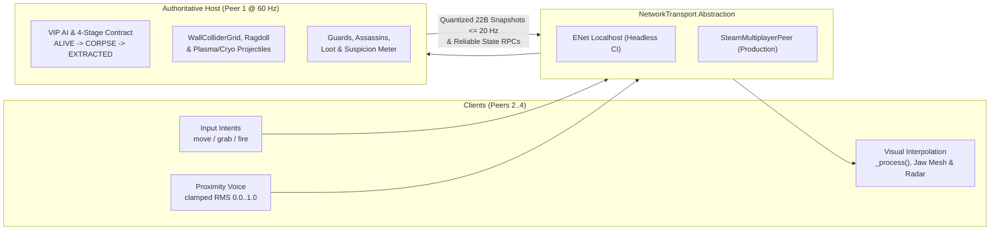

<div align="center">

# BODYGUARD INC.

**2–4 Player Co-op Physics Chaos & Stealth-Action Game — Built on Godot 4.3+ (Forward+ HDR) with Autonomous Gemini Agent Engineering Infrastructure**

[](https://github.com/TPOJL/bodyguard-inc/actions/workflows/ci.yml)
[](https://godotengine.org/)
[](AGENTS.md)
[](#multiplayer-authority-architecture)
[](SECURITY.md)
[](LICENSE)

</div>

---

## Concept & Core Loop

You and 1–3 friends are corporate bodyguards hired to escort a **suicidal, low-IQ AI VIP** across **5 escalating 52m × 136m luxury venues** (plus endless Prestige tiers).

1. **Gear Up at Big Tony's Black-Market Armory (`[U]`):** Every level opens in a safe starting lobby featuring **Big Tony's 3D Arms Dealer Booth** — invest your farmed cash into **8 permanent 5-level upgrade trees** (Plasma Pistol, Cryo-Freeze Rifle, Exo-Grip Servos, Kevlar Cardio, Ventriloquist Modulator, Tactical Utility Belt, VIP Kevlar Tuxedo, and Shock Taser Overdrive).
2. **Freeze, Shatter & Protect (`[LMB/X]` + `[RMB/Z]`):** Defend the VIP from **Rival Assassins**, **6 Lethal Hazards** (Poison Champagne Fountains, Sweeping Sniper Lasers, High-Voltage Terraces), and **armored Guards whose HP scales every level**. Freeze targets solid in 3D ice blocks with the **Cryo-Freeze Rifle** and shatter them with the **Plasma Pistol** for **`2.0x–3.25x` Shatter Crits**!
3. **"Weekend at Bernie's" Protocol (`[E]` + `[V]`):** If the VIP dies *unnoticed*, **the contract is NOT over**. Prop up the limp ragdoll corpse together, bluff through the **Press Photo-Op Stage** and **Charity Auction Podium**, unlock the **Solid Laser Security Gate** with the East Vault **Gold Keycard**, and hold the **North Armored Limousine Extraction Pad** for 5 seconds while **talking (`[V]`) to animate the corpse's 3D jaw** so guards never suspect a thing!

---

## Escalating Multi-Level Venues (`5 Themes + Endless Prestige`)

| Level | Venue Theme | Guard HP | Assassin HP | Visual Atmosphere |
| :---: | :--- | :---: | :---: | :--- |
| **LVL 1** | **The Obsidian Penthouse Gala** | `100 HP` | `140 HP` | Midnight Gold, Royal Crimson Velvet & Veined Obsidian Marble |
| **LVL 2** | **Neon Tokyo Sky-Lounge** | `165 HP` | `230 HP` | Cyber Magenta Carpet, Electric Cyan Accents & Twilight Skyline |
| **LVL 3** | **Monaco Casino Royale** | `230 HP` | `320 HP` | Emerald Felt Velvet & Championship Brushed Brass |
| **LVL 4** | **Alpine Ice Palace Summit** | `295 HP` | `410 HP` | Glacial Sapphire & Frosted Crystal Reflections |
| **LVL 5+** | **Orbital Billionaire Yacht** | `360+ HP` | `500+ HP` | Ultraviolet Platinum, Solar Gold & Endless Prestige Scaling |

---

## Quickstart & Controls

### 1. Launch the Game
```bash
make play
```
*(Need Godot 4.3+ or `gdlint`? Run `./scripts/setup_env.sh --install` first).*

### 2. In-Game Controls
| Key / Input | Action |
| :--- | :--- |
| **`W A S D` / `Arrow Keys`** | Move across the **52m × 136m** multi-zone estate (solid `WallColliderGrid` — zero wall clipping) |
| **`Left Click` / `X`** | **Fire Plasma Pistol** (aimed at cursor/facing; **`2.0x–3.25x` Shatter Crit** on frozen enemies!) |
| **`Right Click` / `Z`** | **Fire Cryo-Freeze Rifle** (freezes Guards & Assassins in a **3D Ice Crystal Block** for `3.5s–9.0s`) |
| **`Hold Shift`** | **Tactical Sprint** (burst speed with Stamina recovery) |
| **`Hold E` / `Hold Space`** | **Grab / Carry VIP** (steer alive VIP or prop up the limp corpse *"Weekend at Bernie's"* style) |
| **`F`** | **Hero Dive-Tackle** (KO nearby Rival Assassins for `+$850` or shove VIP out of Sniper Lasers) |
| **`G`** | **Shock Taser Overdrive** (AOE stun for Assassins & Guards within `5.5m`) |
| **`Q`** | **Throw Decoy Champagne Bottle** (distracts Guards & Paparazzi within `9.0m` for `5.0s+`) |
| **`Hold V`** | **Proximity Voice TALK Bluff (`~0.45 RMS`)** — animates the corpse's 3D jaw & **drains Guard Suspicion** |
| **`Hold B`** | **Proximity Voice SCREAM (`~0.95 RMS`)** — opens corpse jaw wide (`42°`), causes panic |
| **`U`** | **Big Tony's Armory Shop** (walk up to the Lobby Booth or press `[U]` anytime — `1–8` quick-buy or mouse) |
| **`C`** | **Cycle Camera Mode** (`Cinematic Follow` / `Close Action` / `Tactical Overview`) |
| **`K`** | **Instant Kill VIP** (test *"Weekend at Bernie's"* corpse dragging & jaw lip-sync immediately) |
| **`Tab`** | Toggle **AI Co-op Partner Bodyguard** (`OFF` by default in Solo; toggle `ON` anytime) |
| **`H` / `J`** | **Host** (`127.0.0.1:17777`) or **Join** a localhost ENet multiplayer co-op session |
| **`R`** | **Deploy / Restart Current Level** |

---

## Quick Commands ([`Makefile`](Makefile))

| Command | Purpose |
| :--- | :--- |
| `make play` | Launch **BODYGUARD INC.** 3D playable game window (`res://src/scenes/gala_level.tscn`) |
| `make setup-env` | Check/install Godot 4.3+, `gdtoolkit` (`gdlint`), and configure `.githooks` |
| `make security` | Run `secret_guard.py` across the entire repo (API keys, tokens, junk, >10 MB bloat) |
| `make check` | Security guard + `gdlint` + strict GDScript static check (`godot --check-only`) + `multiplayer-netcode-guard` |
| `make test-unit` | Runs all **5 Godot 4.3 headless test suites** (VIP FSM, full multi-level E2E, `wall-collision-bug-hunter`, 300-tick ragdoll stability, `MockAudioInput` lip-sync) |
| `make test-mp` | Headless **1 Host + 2 Clients** localhost ENet Godot 4.3 co-op smoke test |
| `make test-perf` | 1,000-tick headless party benchmark enforcing `P95 <= 12ms`, `P99 <= 16.67ms`, `orphan_nodes == 0` |
| `make verify-all` | Execute the complete autonomous CI quality gate locally |

---

## Multiplayer Authority Architecture

All authoritative simulation runs on the **Host (`peer_id == 1`)** at a deterministic fixed `60 Hz` tick rate (`_physics_process`). Clients send only clamped input intents and normalized voice RMS floats (`[0.0, 1.0]`).



---

## Autonomous Gemini Agent Infrastructure

Engineered for autonomous development and zero-regression verification under **[AGENTS.md](AGENTS.md)**.

### 6 Specialized Agent Skills (`.agent/skills/`)
| Skill | Domain & Automated Verification |
| :--- | :--- |
| [`wall-collision-bug-hunter`](.agent/skills/wall-collision-bug-hunter/SKILL.md) | Automated anti-clipping detector driving Players, VIP, Guards, Assassins & Projectiles into every wall, column, vendor booth, table, and locked gate. |
| [`ragdoll-physics-tuner`](.agent/skills/ragdoll-physics-tuner/SKILL.md) | Active ragdoll joint limits, critically damped grab spring-damper math (`F = 280x - 34v`), corpse profiles, and 300-tick stability test. |
| [`multiplayer-netcode-guard`](.agent/skills/multiplayer-netcode-guard/SKILL.md) | Host-authoritative `@rpc` security rules, 22-byte quantized ragdoll sync (`< 2.4 KB/s`), Steam-to-ENet abstraction, and static RPC auditor. |
| [`headless-coop-playtester`](.agent/skills/headless-coop-playtester/SKILL.md) | Simultaneous **1 Host + 2 Headless Clients** localhost ENet orchestrator injecting bot intents with zero-tolerance log scanning. |
| [`voice-lipsync-mock`](.agent/skills/voice-lipsync-mock/SKILL.md) | `AudioInputDriver` + deterministic `MockAudioInput` (`SILENCE`, `TALKING`, `SCREAMING`) for hardware-free corpse jaw & guard tests. |
| [`clip-telemetry-profiler`](.agent/skills/clip-telemetry-profiler/SKILL.md) | 1,000-tick headless party stress profiler enforcing `P95 <= 12.0 ms`, `P99 <= 16.67 ms`, and `orphan_nodes == 0`. |

### Lifecycle Hooks (`.agent/hooks.json` & `.githooks/`)
| Lifecycle Event | Hook Script | Enforced Guarantees |
| :--- | :--- | :--- |
| **Post-Edit** (`PostToolUse`) | [`.agent/hooks/post-edit.sh`](.agent/hooks/post-edit.sh) | Runs `gd_static_check.py` (strict typing, `gdlint`, `godot --check-only`) immediately after editing `.gd` files. |
| **Pre-Commit** (`git commit`) | [`.agent/hooks/pre-commit.sh`](.agent/hooks/pre-commit.sh) | Blocks secrets/junk/>10 MB bloat (`secret_guard.py --staged`), runs all 5 Godot unit suites, runs `multiplayer-netcode-guard`. |
| **Stop / Pre-Push** (`Stop`, `git push`) | [`.agent/hooks/stop-gate.sh`](.agent/hooks/stop-gate.sh) | Runs full-repo `secret_guard.py --all`, 1 Host + 2 Clients co-op smoke test, and 1,000-tick orphan-node profiler. |

---

## Anti-Leak & Security Shield

Protected across **4 layers** (see [SECURITY.md](SECURITY.md)):
1. **Hardened [`.gitignore`](.gitignore)** blocking `.env*`, private keys, credentials, Godot export presets, logs, and OS/IDE junk.
2. **Active Secret Scanner ([`scripts/secret_guard.py`](scripts/secret_guard.py))** detecting Gemini/Google, GitHub, OpenAI/Anthropic, AWS, Stripe, Slack, Discord, PEM keys, DB URLs, high-entropy secrets, junk filenames, and assets `> 10 MB`.
3. **Mandatory Git Hooks (`.githooks/pre-commit` & `pre-push`)**.
4. **GitHub Actions CI ([`.github/workflows/ci.yml`](.github/workflows/ci.yml))** running `make verify-all` on every push & PR.

---

## Repository Layout

```text
bodyguard-inc/
├── AGENTS.md                       # Core Gemini/Antigravity Engineering Constitution
├── README.md                       # Project showcase, controls, venues & architecture
├── CONTRIBUTING.md                 # Contributor workflow & verification checklist
├── SECURITY.md                     # Anti-leak security policy & secret scanner docs
├── LICENSE                         # MIT License
├── Makefile                        # Single-command quality gates & `make play`
├── project.godot                   # Godot 4.3+ config (Forward+, 60 Hz physics, strict typing)
├── .gdlintrc                       # GDScript linter configuration (matches GitHub CI)
├── .env.example                    # Safe environment variable template
├── .gitignore / .gitattributes     # Hardened secret/junk ignore & cross-platform rules
├── .githooks/                      # Git pre-commit & pre-push entrypoints
├── .github/
│   ├── workflows/ci.yml            # GitHub Actions CI (Godot 4.3 + gdlint + verify-all)
│   ├── PULL_REQUEST_TEMPLATE.md    # Standard PR verification checklist
│   └── ISSUE_TEMPLATE/             # Bug report & feature request templates
├── .agent/
│   ├── hooks.json                  # Antigravity lifecycle hooks (PostToolUse, Stop)
│   ├── hooks/                      # post-edit.sh, pre-commit.sh, stop-gate.sh
│   └── skills/                     # 6 autonomous agent skills + automated test scripts
├── scripts/
│   ├── secret_guard.py             # API key, secret, junk & >10MB bloat scanner
│   ├── gd_static_check.py          # Strict static GDScript type, gdlint & Godot check-only
│   ├── find_godot.sh               # Cross-platform Godot 4 binary locator
│   └── setup_env.sh                # Environment setup & dependency installer
├── src/
│   ├── core/                       # NetworkTransport, AudioInputDriver, RagdollPhysics, AgencyProgression, SynthSfx
│   ├── vip/                        # Authoritative VIP AI, Sculpted Active Ragdoll & Articulated Jaw Rig
│   ├── player/                     # Sculpted Secret Service Bodyguard & AI Co-op Partner Controller
│   ├── ui/                         # Neo-Glass 2026 Broadcast HUD, 2-Column Armory Shop & Live Tactical Minimap
│   ├── world/                      # LevelThemes, WallColliderGrid, CharacterRigBuilder, VendorBooth, ProjectileBolt,
│   │                               # GuardNpc (Cryo-Freeze + HP), AssassinNpc, HazardZone, LootPickup, ProceduralTextures
│   └── scenes/                     # Full Playable 52m x 136m Multi-Level GalaLevel (gala_level.tscn)
└── tests/
    ├── unit/                       # 5 Godot 4.3 headless suites (VIP, Multi-Level E2E, Wall-Collision, Ragdoll, Voice)
    └── mp/                         # Headless 1 Host + 2 Clients ENet test harness
```
